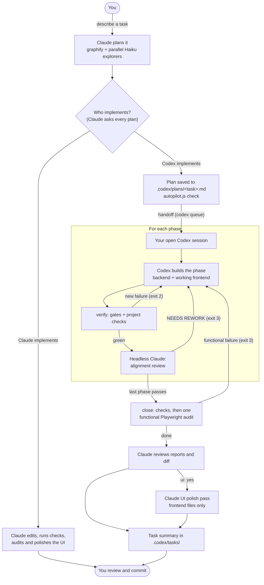
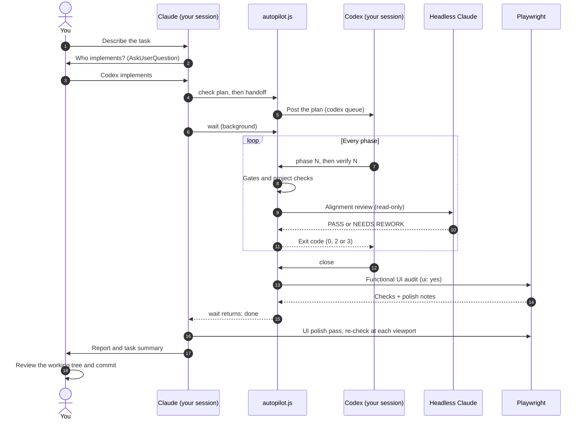
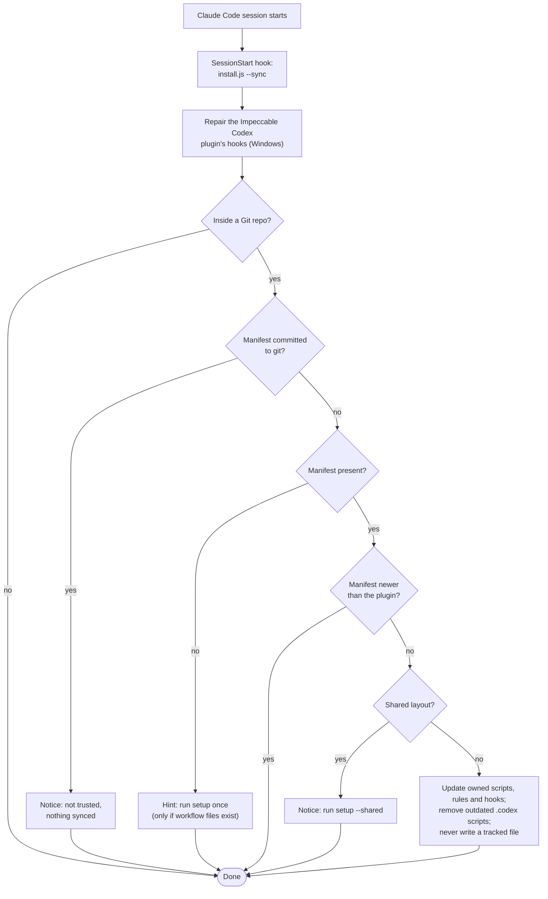

# Dual-agent workflow (Claude + Codex)

A Claude Code plugin and standalone installer that lets Claude and Codex work on one Git project as a team. Claude plans, reviews and owns the look and feel of the UI. Codex builds the backend and a first working frontend. Local scripts check every step in between. One setup command installs the missing tools (Claude Code, Codex CLI, **Playwright MCP and Chromium**, graphify) and wires the workflow into the project.

Everything the workflow writes stays **local to your clone**. Plans, logs, task summaries and the agents' rules are hidden through `.git/info/exclude`, and setup never edits a file git tracks. Agents never commit, stage, stash or push. You review the working tree and commit it yourself.

> The plugin was called `claude-codex-workflow` before v3.1. Claude Code reserves plugin names that start with `claude-`, so it is now **`dual-agent-workflow`**. See [Moving from the old plugin name](#moving-from-the-old-plugin-name). The GitHub repository keeps its name.

## Contents

- [How it works](#how-it-works)
- [Step by step: install once](#step-by-step-install-once)
- [Step by step: each project](#step-by-step-each-project)
- [Daily use: what happens during a task](#daily-use-what-happens-during-a-task)
- [What stays local, and what the installer may touch](#what-stays-local-and-what-the-installer-may-touch)
- [Updating](#updating)
- [Configure verification](#configure-verification)
- [Token usage for Claude and Codex](#token-usage-for-claude-and-codex)
- [Reports and troubleshooting](#reports-and-troubleshooting)
- [Limitations](#limitations)
- [Upgrading from 2.x](#upgrading-from-2x)
- [Development](#development)

## How it works

### The big picture



### One task, in order



### Who does what

| Part | Role in this setup | Why it helps |
|---|---|---|
| Claude Code (interactive) | Plans, asks who implements, reviews, **polishes the UI**, writes the task summary | Turns a request into acceptance criteria and phases; owns visual and UX quality |
| Codex CLI | Implements approved phases: **backend and a first working frontend**; fixes gate and alignment findings | Carries a task through every phase from one handoff |
| Headless Claude | One read-only alignment review per passing phase; one functional UI audit at close | A second opinion checked against the plan, with write tools denied |
| Playwright MCP + Chromium | The functional audit at close and Claude's polish pass | Real navigation, clicks, forms, console errors, failed requests and screenshots at several viewports |
| graphify | Shared code graph and search/read guards | Finds affected modules and dependents before editing |
| Haiku Explore subagents | 2–4 in parallel whenever Claude explores several files | Fast, cheap exploration; Claude keeps decisions and edits |
| Impeccable (optional) | Design skills that Claude runs during the polish pass | Uses `PRODUCT.md` and `DESIGN.md` as design context |
| caveman (optional) | Terse replies | Less prose output; no fixed saving is guaranteed |
| `autopilot.js` and `claude-verify.js` | Local Node scripts under `.codex/` | Snapshots, gates, reviews, verdicts and closing. They coordinate the agents; they are not another model |

Choosing **Claude implements** skips the handoff, the per-phase reviews and the headless calls. Use it for small changes where the extra review isn't worth the time and usage.

## Step by step: install once

Do this once per machine.

1. **Check the prerequisites.**
   - Node.js with `npm` and `npx`. The installer needs Node 18+; browser tooling needs a current LTS (Node 22 or 24).
   - Git.
   - Claude and Codex accounts, or API authentication. Installing the CLIs doesn't sign you in.
   - `uv`, `pipx` or Python, if graphify needs installing.
   - An operating system that [Playwright supports](https://playwright.dev/docs/intro#system-requirements).
2. **Add the plugin** in Claude Code:

   ```text
   /plugin marketplace add Jonrei1/Claude-Codex-Workflow
   /plugin install dual-agent-workflow@dual-agent-workflow
   ```

   Without the plugin, run the installer straight from GitHub instead (see the next section).
3. **Sign in.** Run `claude` and follow its sign-in flow, and run `codex login` if needed.
4. **Restart Claude Code**, so it loads the plugin and its SessionStart hook.

## Step by step: each project

Do this in every repository that should use the workflow. Start from a Git repository: run `git init` yourself first for a new app.

1. **Run setup** from the project:

   ```text
   /dual-agent-workflow:setup --yes
   ```

   Or, without the plugin, from the project root:

   ```sh
   npx github:Jonrei1/Claude-Codex-Workflow --yes
   npx github:Jonrei1/Claude-Codex-Workflow --dry-run   # show what it would do, change nothing
   ```

   Before it runs, Claude asks two questions, because the installer can't prompt from inside Claude:

   | Question | Asked when | Your choices |
   |---|---|---|
   | Install **Impeccable**? | Unless you passed `--impeccable` or `--skip-impeccable` | Yes adds design skills and hooks; no skips them. Mainly useful for UI work. |
   | Install **graphify** for your user or globally? | Only when graphify is missing and you didn't pass `--graphify-scope` | **User** (recommended, no admin rights) or **global** (system-wide `pip`, usually admin). |

   `--yes` approves missing global tools (Claude Code and Codex CLI through npm), the Chromium download and missing Playwright MCP registrations. It doesn't answer the two questions. After the first project, use `--project-only` to skip the machine setup.
2. **Read the output.**
   - Every line is `ok`, `--` (skipped or only pointed out) or `FAIL`.
   - "tracked by git, left unchanged" is expected. The workflow uses a local equivalent and never edits a tracked file.
   - The installer prints the checks it detected (lint, typecheck, test, build).
3. **Fix the checks if they're wrong.** If the detected checks are wrong or empty, add `.codex/verify.json` (see [Configure verification](#configure-verification)). For apps with a UI, add its `ui` block (start command, URL, viewports).
4. **Restart Claude Code and Codex.** Claude loads `CLAUDE.local.md` and the plan hook at startup. In Claude, check `/mcp` for Playwright.
5. **Trust the hooks in Codex.** Run `/hooks` in Codex and trust the workflow hooks. Any later change to a hooks file needs trusting again.
6. **Approve headless runs.** When Codex asks, let `autopilot.js verify` and `close` use the network and a 30-minute timeout. They start headless Claude sessions.
7. **Build the code graph.** Once the project has code, run `/graphify .` in Claude Code. If a user-scope graphify isn't found, add `~/.local/bin` (or Python's user scripts folder) to `PATH`.
8. **Optional design context.** With Impeccable, run `/impeccable init` for `PRODUCT.md`, and `/impeccable document` for `DESIGN.md` in an existing UI.
9. **Keep a Codex session open** in the repo. Claude posts plans into it.

### What setup writes

| Step | Action | Location |
|---|---|---|
| Prerequisites | Checks Node and Git; reports what's missing instead of installing it | Your machine |
| Agent CLIs | Installs a missing `@anthropic-ai/claude-code` and `@openai/codex` | Global npm packages |
| Playwright | Installs a missing `@playwright/mcp` and the Chromium build that matches it | Global npm package and browser cache |
| Browser connections | Adds a missing `playwright` MCP registration for Claude (and Codex with `--playwright-codex`) | `~/.claude.json` (and `~/.codex/config.toml`) |
| graphify | Installs a missing graphify: user scope via `uv tool`, `pipx` or `pip --user`; global via `pip` | User directory or system-wide |
| Helper scripts | Copies or updates the workflow-owned scripts and Codex rules | `.codex/autopilot.js`, `.codex/hooks/*.js`, `.codex/workflow/CODEX.md` |
| Claude rules and plan hook | Merges the `## Workflow` section and an `ExitPlanMode` hook | `CLAUDE.local.md`, `.claude/settings.local.json` |
| Codex hooks | Merges the graphify guards into an untracked project hooks file; removes the old v2 Stop hook | `.codex/hooks.json`, `~/.codex/hooks.json` |
| Templates and skills | Creates the plan template and caveman skills; moves untracked plans out of an old `plans/` folder | `.codex/plans/`, `.claude/skills/caveman/`, `.agents/skills/caveman/` |
| Impeccable (opt-in) | Runs `npx -y impeccable install --project --providers=claude,codex` | Impeccable's skills and hooks |
| Impeccable plugin repair (Windows) | Points the Impeccable Codex plugin's hooks at a Node launcher | `~/.codex/plugins/cache/impeccable/` |
| Hiding | Adds every workflow path to `.git/info/exclude` (never `.gitignore`) | `.git/info/exclude` |
| Manifest | Records what this version installed, so later versions can remove scripts it dropped | `.codex/workflow-manifest.json` |

### Flags

| Flag | Effect |
|---|---|
| `--yes` | Approve missing machine tools and Playwright setup without prompts. Doesn't install Impeccable; graphify uses user scope. |
| `--dry-run` | Print what would happen; install and write nothing. |
| `--tools-only` | Machine tools, Chromium and Playwright registrations only. |
| `--project-only` | Project files only; skip machine installs, the Chromium download and MCP registration. |
| `--skip-playwright` | Skip the Playwright package, browser download and registrations. |
| `--playwright-codex` | Also register Playwright MCP for Codex. By default only Claude gets it, since Claude does the UI audits and polish. |
| `--shared` | Team-wide layout in tracked files: sections in `CLAUDE.md` and `AGENTS.md`, `.gitignore` entries, graphify's project installers. Commit them as a team. |
| `--update-sections` | With `--shared`: replace existing workflow sections in `CLAUDE.md` and `AGENTS.md`. |
| `--graphify-scope=user` or `global` | Where a missing graphify is installed, without asking. |
| `--skip-graphify` | Skip graphify's project integrations (which only run with `--shared`). |
| `--impeccable` / `--skip-impeccable` | Install Impeccable, or don't and don't ask. |
| `--impeccable-providers=codex` | Implies `--impeccable`; installs design skills for Codex only, when Claude already uses the Impeccable plugin. |
| `--sync` | Quiet, files-only upgrade of a set-up project. Run by the plugin's SessionStart hook. |
| `--root <dir>` | Configure the Git repository that contains `<dir>`. |

## Daily use: what happens during a task

1. **Plan.** Describe the task to Claude.
   - Claude explores with `graphify query` and 2–4 parallel Haiku Explore subagents, then proposes a plan.
   - For every plan that changes app code, it asks who implements: **Codex (Claude orchestrates)**, **Claude implements**, or **Codex, manual phases**.
2. **Check the plan.** Claude saves the approved plan to `.codex/plans/<task>.md` and runs `node .codex/autopilot.js check .codex/plans/<task>.md` until every checklist item passes.
   - Every plan has acceptance ids, scoped phases, runnable gates and explicit Hands off.
   - With `ui: yes`, one `## UI audit` section gives the start command, URL, viewports and checks.
3. **Optional plan review.** For `review: codex` or `risk: high`, Claude runs `autopilot.js review`. That is one read-only `codex exec` call. Claude goes through the findings with you before the handoff.
4. **Hand off.** `autopilot.js handoff` posts the plan into your open Codex session through `codex queue`.
   - It picks the newest session in the repo, or the one pinned with `--thread <id>`.
   - It waits up to 90 seconds for one to open. Exit 5 prints a line to paste instead.
   - Claude then starts `autopilot.js wait` in the background.
5. **Build each phase.** Codex runs `begin`, then `phase N`, implements within the phase's scope, and runs `verify N`.
   - `begin` snapshots the untouched tree and records every failing check as a baseline, so failures that already existed don't block the run.
   - Gates and project checks run as one deduplicated set, concurrently, with builds last.
   - A new failure returns exit 2 to Codex with no model call. Three in a row stop the run.
6. **Review each phase.** Once the checks are green, one read-only headless Claude call (Sonnet, or Opus for high risk) reviews the phase against Done when, Covers and Hands off.
   - NEEDS REWORK returns exit 3 to Codex. A third failure stops the run.
7. **Close.** For `ui: yes`, the checks run, then one headless **functional** Playwright audit.
   - It fails only on functional problems: an unreachable plan item, layout that blocks interaction, console errors, failed requests, or unlabeled controls. Those go back to Codex.
   - Visual issues become "Polish notes for Claude" and never cost a Codex rework.
   - Then `graphify update .` runs and the run is done.
8. **Claude reviews.** When `wait` returns, Claude reads the per-phase reports and the UI report, and spot-checks the diff.
9. **UI polish (`ui: yes`).** Claude makes one time-boxed pass:
   1. It maps the frontend with Haiku explorers.
   2. It edits frontend files only, using Impeccable when installed.
   3. It re-checks with Playwright at every viewport and runs the project checks.
   4. It appends `## Claude polish` to the UI report.
10. **Summary and commit.** Claude writes `.codex/tasks/<date>-<task>.md` and reports to you. You review the working tree and commit it.

If a run gets stuck or fails, Claude explains why and asks before sending `handoff --continue`.

With **manual phases**, `handoff --phase N` sends one phase at a time. A passing phase pauses the run, and `wait` prints the next `handoff --phase` command. `wait` also notices when a Codex turn ends or its session closes mid-run, and passes on Codex's last message. Snapshots use a temporary Git index and tree objects, so your staging area and branches are untouched.

## What stays local, and what the installer may touch

| Where | What | Visible to teammates? |
|---|---|---|
| `.codex/` (scripts, plans, verify reports, tasks, rules, manifest) | Written and updated by setup and sync | No: hidden by `.git/info/exclude` |
| `CLAUDE.local.md`, `.claude/settings.local.json` | Claude's rules and the plan hook | No: hidden |
| `.claude/skills/caveman/`, `.agents/skills/caveman/`, `.agents/skills/impeccable/`, `.impeccable/`, `graphify-out/` | Skills and caches | No: hidden while untracked |
| Any file git tracks | **Never written** (outside `--shared`). Problems in one are reported with the exact fix. | Unchanged |
| `~/.codex/hooks.json` | Only the old v2 Stop hook is removed, and a broken Impeccable command there is repaired | Per machine |
| `~/.codex/plugins/cache/impeccable/*/hooks/` (Windows) | The Impeccable Codex plugin's hooks are pointed at a Node launcher | Per machine |
| `~/.claude.json`, `~/.codex/config.toml`, global npm, browser cache | Only during full setup: missing tools and registrations | Per machine |

**Rules that keep upgrades safe:**

- **No tracked writes.** Setup and sync refuse to write or delete a tracked file, and refuse any path reached through a symlink.
- **Narrow removals.** Removing an outdated script only works on `.codex/*.js`, `.codex/hooks/*.js` and `.codex/workflow/*.md`. A manifest that lists anything else (`.env`, `.git/config`, a plan, a `..` path) is ignored.
- **Committed manifests aren't trusted.** If `.codex/workflow-manifest.json` is committed to git, sync stops and says so.
- **Shared layout isn't synced.** A manifest can't switch a project to the shared layout, and sync never upgrades a `--shared` project, because that layout lives in tracked files.
- **No downgrades.** A project set up by a newer plugin version is never taken back, by sync or by setup.
- **Edits are kept.** Files you edit (the plan template, caveman skills) are kept. Only untouched copies are refreshed.
- **BOM-safe.** JSON files saved with a UTF-8 BOM (Windows PowerShell 5.1) are read correctly.

## Updating



After `/plugin update dual-agent-workflow`, the SessionStart hook syncs every project that already uses the workflow:

- **Seamless:** no re-run of setup, and it is silent when there's nothing to do.
- **Old projects:** a project set up before automatic updates (no manifest) gets a one-line hint to run `/dual-agent-workflow:setup --project-only` once.
- **Restart afterwards:** restart Claude Code and Codex so they reload the rules and scripts.

### Moving from the old plugin name

Projects need nothing: their files and manifest carry over, and the next session's sync updates them. On each machine, replace the plugin:

```text
/plugin uninstall claude-codex-workflow@claude-codex-workflow
/plugin marketplace remove claude-codex-workflow
/plugin marketplace add Jonrei1/Claude-Codex-Workflow
/plugin install dual-agent-workflow@dual-agent-workflow
```

Uninstall the old plugin rather than keeping both. The old plugin's sync still repairs Impeccable hooks in tracked files, and it runs before it notices the newer manifest.

## Configure verification

Checks are detected from root Node, Rust, Go and Python markers. For monorepos or custom checks, save `.codex/verify.json` with commands your project supports:

```json
{
  "checks": ["npm run typecheck", "npm run lint", "npm test"],
  "parallelChecks": true,
  "alignment": { "model": "sonnet", "effort": "medium", "riskModel": "opus", "riskPaths": ["src/auth/**", "migrations/**"] },
  "ui": { "startCommand": "npm run dev", "url": "http://localhost:3000", "readyTimeoutSec": 90, "viewports": [375, 1280], "model": "sonnet", "effort": "medium" },
  "handoff": { "thread": "", "waitSeconds": 90 },
  "headless": { "settingSources": "project,local" }
}
```

What each setting does:

- **`checks`:** replaces detection. `[]` disables project checks; phase gates still run.
- **`parallelChecks: false`:** runs the checks one after another.
- **`baseline: false`:** disables the starting failure baseline. Failures are compared by diagnostic lines, ignoring locations, counts and timings.
- **`ui`:** the plan's `## UI audit` section overrides the start command, URL and viewports.
- **`headless.settingSources`:** optional. Your user settings may carry authentication or proxy settings that this would skip.

Inspect the result:

```sh
node .codex/hooks/claude-verify.js --print-checks
node .codex/autopilot.js check .codex/plans/<task>.md
```

For repeatable UI acceptance, prefer a project `@playwright/test` spec gate with aria snapshots (`toMatchAriaSnapshot`) or `@axe-core/playwright`. Minimal Linux systems may need [Chromium's system dependencies](https://playwright.dev/docs/browsers).

## Token usage for Claude and Codex

The installer calls no models; running it through Claude uses conversation tokens. Claude and Codex bill separately, and headless Claude uses your own authenticated account or API key.

**How many headless calls:**

- Headless Claude calls = **(phases + reworks)** alignment calls, plus **(1 + UI reworks)** when `ui: yes`. Three phases without rework use three calls, or four with UI.
- Gate and check failures before alignment add no model calls.
- Plan review is one Codex call.

**What isn't counted:** interactive planning, the polish pass and the summary are normal Claude session usage. The Haiku explorers are cheap, but they still count. Calls may contain several turns; call counts are not token counts.

**The usage log:** each headless call records tokens, cache usage, model, effort, turns and API list-price cost in `.codex/verify/usage.jsonl`:

```sh
node .codex/autopilot.js usage
node .codex/autopilot.js usage .codex/plans/<task>.md
```

The log excludes Codex and interactive sessions, and an API-equivalent estimate is not a subscription invoice. See [Claude cost guidance](https://code.claude.com/docs/en/costs) and the [Codex CLI reference](https://learn.chatgpt.com/docs/developer-commands?surface=cli).

## Reports and troubleshooting

| File | Purpose |
|---|---|
| `.codex/autopilot/status.json`, `<task>.log` | Run state, phase, reason and progress |
| `.codex/autopilot/<task>.baseline.json` | Gate and check failures from before the task |
| `.codex/verify/<task>/plan-review.json` | Read-only plan findings |
| `.codex/verify/<task>/phase-<N>.*` | Alignment, gate/check output and diff per phase |
| `.codex/verify/<task>/final-ui-audit.md`, `final-ui/` | Functional UI report, polish notes, Claude's polish section, screenshots |
| `.codex/verify/last.log`, `alignment.md`, `phase.diff` | Latest alignment run |
| `.codex/verify/usage.jsonl` | Headless Claude usage |
| `.codex/tasks/<date>-<task>.md` | Claude's task summary |

**Handoff and runs:**

- **The plan didn't reach Codex:** keep a Codex session open in the repo, pin one with `--thread`, or paste the exit-5 line. Queue support needs a recent Codex CLI.
- **`wait` timed out (6):** check the Codex session, then wait again.
- **Stuck (4) or failed (1):** read the reason and reports, fix the blocker, then hand off with `--continue`.

**Checks and headless calls:**

- **Checks conflict when run together:** set `"parallelChecks": false`. For wrong checks, use `verify.json`.
- **Headless launch or network failure:** check CLI sign-in, `PATH` and permissions, and allow a 30-minute timeout for `review`, `verify` and `close`.

**UI:**

- **UI BLOCKED:** check `final-ui.app.log`, the app URL, the browser installation and login state. Project-only setup doesn't install Playwright; run full setup.

**Hooks:**

- **A Codex hook fails on every event ("Design deep pass" / "Checking UI changes"):** Impeccable's hooks use shell syntax that PowerShell rejects.
  - Setup and every session start repair the Impeccable Codex plugin's cache and untracked hooks files.
  - A **tracked** `.codex/hooks.json` is only reported, with the exact `commandWindows` value to commit.
  - Trust the hooks again in Codex (`/hooks`) after a repair.
- **"…is committed to git, so it isn't trusted":** run `git rm --cached .codex/workflow-manifest.json`, then run setup once.
- **"…uses the shared layout":** run `/dual-agent-workflow:setup --project-only --shared` to upgrade it.
- **"…newer than this plugin":** update the plugin; setup won't downgrade the project.

**Impeccable:** it is optional. Remove its live-mode block (`impeccable-live-start` … `impeccable-live-end`) before committing.

## Limitations

**Platforms and tools**
- **Windows first.** It is developed and tested mostly on Windows; macOS and Linux paths are covered by tests, but less exercised in daily use.
- **Impeccable plugin repair is Windows-only.** Upstream's commands already work in POSIX shells.
- **The Codex handoff uses `codex queue` and the Codex app-server**, which are experimental. Older or changed Codex CLIs fall back to a line you paste.
- **Headless Claude needs network access, sign-in and up to 30 minutes per call.** Codex's sandbox may block it until you approve running outside the sandbox.
- **graphify's guard hooks need `graphify` on the `PATH` Codex sees.** Otherwise they error; use its full path in `.codex/hooks.json`.
- **Check detection only reads root markers.** Monorepos and unusual stacks need `.codex/verify.json`.

**UI audit and polish**
- **Logins aren't automated.** The app must start with one command and answer at a URL. Login flows, seeded data and auth state are yours to provide.
- **The audit is functional only.** It doesn't compare pixels.
- **The polish pass is a single, time-boxed, judgment-based pass by your interactive Claude session.** It runs only while that session is open, and it is not a full redesign.
- **BLOCKED doesn't fail `close`.** A missing browser or an app that won't start is reported, but the run still finishes.

**Local-only guarantees**
- **`.git/info/exclude` is per clone.** Every teammate runs setup in their own clone, and exclusion can't hide a file that is already tracked.
- **Tracked files are never fixed for you.** A tracked `.codex/hooks.json` with the old Stop hook or a broken Impeccable command, and the shared layout, need a normal team commit.
- **Sync restores the workflow's hooks.** If you delete the graphify guards or the `ExitPlanMode` hook from the local files, the next session adds them back.
- **The `## Workflow` section in `CLAUDE.local.md` belongs to the plugin.** Edits inside it are replaced on update; keep your own notes outside it.
- **Merged JSON files are rewritten.** `.claude/settings.local.json` and an untracked `.codex/hooks.json` come back with 2-space indentation and LF line endings.
- **Case-only path differences** on case-insensitive file systems can hide a tracked file from the tracked-file check.
- **Two sessions starting at the same moment** can, rarely, append the exclude block twice. That is harmless.

**Third-party code**
- **The Impeccable plugin repair edits another plugin's cache.** Right after an Impeccable update, its hooks fail until the next setup or Claude Code session start re-applies the repair.
- **Impeccable is installed with `npx -y impeccable`, unpinned**, and writes its own files. `PRODUCT.md` and `DESIGN.md` are not hidden, so review them before committing.

**Usage and naming**
- **Orchestration costs time and model usage:** headless reviews, audits and Haiku explorers. For small changes, choose **Claude implements**.
- **The rename needs one manual step per machine.** The old `claude-codex-workflow` plugin must be uninstalled.

## Upgrading from 2.x

Re-run setup. Version 3 removes `autopilot.js run`, `--resume`/`--force` for that driver, `--new-terminal`, the Codex Stop hook and its locks, `phase.json` inference, headless `triage` and `.orig.md`, the Step A fixer (`checks-fix`), per-phase UI audit blocks and headless task-summary calls. Legacy workflow hooks are removed from untracked project hook files and from `~/.codex/hooks.json`, preserving unrelated entries; a tracked hooks file is only pointed out. Existing customized plan templates are kept: align them with the bundled v3 template.

## Development

```sh
npm install   # Vitest 5, pinned in package-lock.json; needs Node 22.12+ (the installer itself runs on Node 18+)
npm test      # vitest run
```

The tests use fake `claude` and `codex` CLIs and temporary repositories. Every test file gets its own temporary `CODEX_HOME`. They make no model calls, download no browsers and don't change your user configuration. `node_modules/` is git-ignored, and only `skills/` ships to npm, so installed users never need the dev dependencies.

| Path | Purpose |
|---|---|
| `.claude-plugin/` | Plugin and marketplace manifests (`claude plugin validate .`) |
| `commands/setup.md` | The `/dual-agent-workflow:setup` command |
| `hooks/hooks.json` | SessionStart hook that runs `install.js --sync` |
| `skills/claude-codex-workflow/SKILL.md` | Setup reference: flags, check detection, file destinations |
| `skills/claude-codex-workflow/scripts/` | `install.js` (installer and sync) and `playwright.js` |
| `skills/claude-codex-workflow/templates/` | Claude and Codex rules, plan template, `.codex/` helper scripts, caveman skill |
| `tests/` | Vitest suites and the fake Codex fixture |
