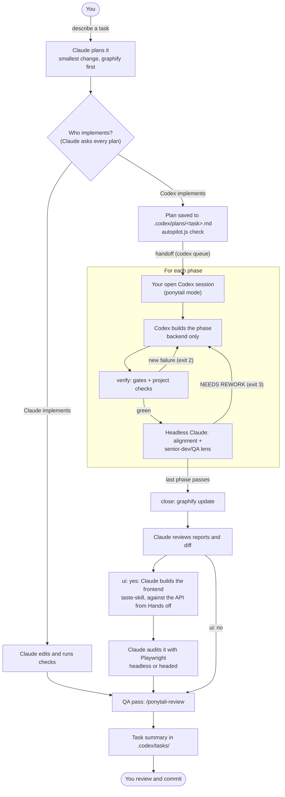
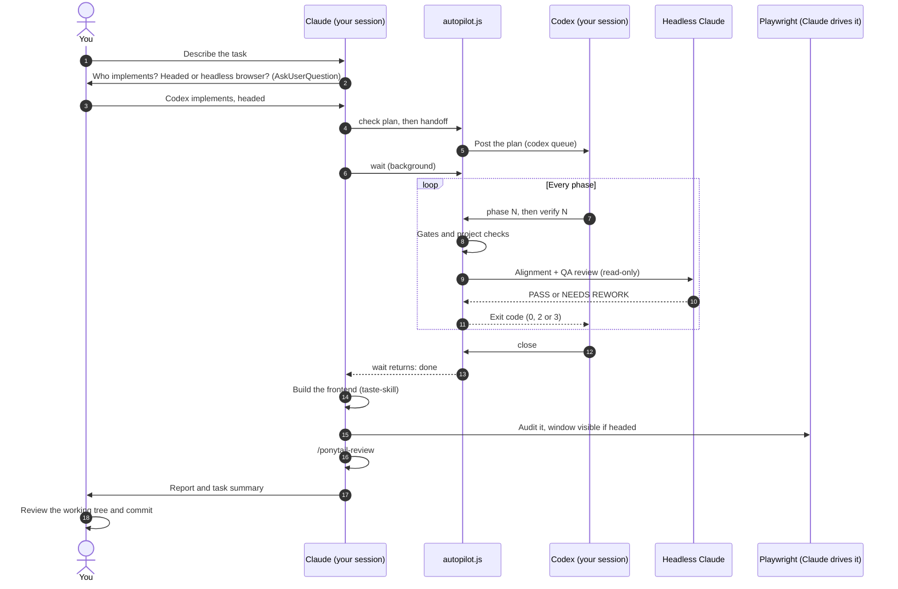
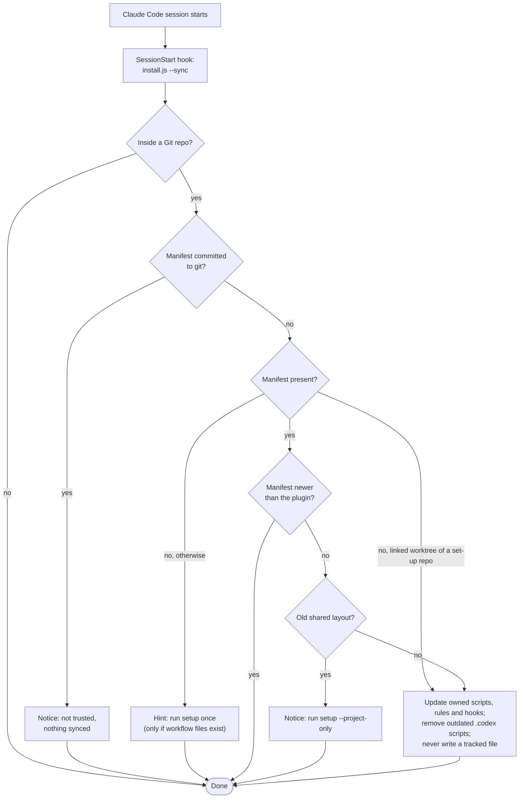

# Dual-agent workflow (Claude + Codex)

A Claude Code plugin and standalone installer that lets Claude and Codex work on one Git project as a team. Claude plans, reviews and **builds every frontend itself, from the start**. Codex builds the backend only. Local scripts check every step in between. Two plugins keep the work small and good: **ponytail** (a senior developer and QA reviewer) and **taste-skill** (UI/UX direction). One setup command installs what's missing (Claude Code, Codex CLI, **Playwright MCP and Chromium**, graphify, ponytail, taste-skill) and wires the workflow into the project.

Everything the workflow writes stays **local to your clone**. Plans, logs, task summaries and the agents' rules are hidden through `.git/info/exclude`, and setup never edits a file git tracks. Agents never commit, stage, stash or push. You review the working tree and commit it yourself.

> The plugin was called `claude-codex-workflow` before v3.1. Claude Code reserves plugin names that start with `claude-`, so it is now **`dual-agent-workflow`**. See [Upgrading](#upgrading). The GitHub repository keeps its name.

## Contents

- [How it works](#how-it-works)
- [Step by step: install once](#step-by-step-install-once)
- [Step by step: each project](#step-by-step-each-project)
- [Daily use: what happens during a task](#daily-use-what-happens-during-a-task)
- [Several developers, one repo](#several-developers-one-repo)
- [What stays local, and what the installer may touch](#what-stays-local-and-what-the-installer-may-touch)
- [Updating](#updating)
- [Configure verification](#configure-verification)
- [Cost of a run](#cost-of-a-run)
- [Reports and troubleshooting](#reports-and-troubleshooting)
- [Limitations](#limitations)
- [Upgrading](#upgrading)
- [Development](#development)

## How it works

### The big picture



### One task, in order



### Who does what

| Part | Role in this setup | Why it helps |
|---|---|---|
| Claude Code (interactive) | Plans, asks who implements, **builds every frontend**, audits it, runs the QA pass, writes the task summary | Turns a request into acceptance criteria and phases; one owner for all UI means no Codex-builds-then-Claude-fixes rework |
| Codex CLI | Implements approved phases: **the backend only**; fixes gate and alignment findings | Carries a task through every phase from one handoff; never touches frontend files |
| Headless Claude | One read-only alignment and QA review per passing phase; frontend files in a Codex phase count as out of scope | A second opinion checked against the plan, with write tools denied |
| ponytail | Senior dev and QA: the smallest change that solves the task, plus `/ponytail-review` | Fewer phases, no speculative dependencies or abstractions, a real QA pass |
| taste-skill | UI/UX art direction while Claude builds the frontend | Less generic UI, with bounds so the work can't balloon |
| Playwright MCP + Chromium | Claude's own check of the frontend it built, **headless or headed** | Real navigation, clicks, forms, console errors, failed requests and screenshots at several viewports; headed lets you watch |
| graphify | Shared code graph and search/read guards | Finds affected modules and dependents before editing |
| `autopilot.js` and `claude-verify.js` | Local Node scripts under `.codex/` | Snapshots, gates, reviews, verdicts and closing. They coordinate the agents; they are not another model |

Choosing **Claude implements** skips the handoff, the per-phase reviews and the headless calls. Use it for small changes where the extra review isn't worth the time and usage.

## Step by step: install once

Do this once per machine.

1. **Check the prerequisites.**
   - Node.js with `npm` and `npx`. The installer needs Node 18+; browser tooling needs a current LTS (Node 22 or 24).
   - Git.
   - Claude and Codex accounts, or API authentication. Installing the CLIs doesn't sign you in.
   - `uv`, `pipx` or Python, if graphify needs installing.
   - An operating system that [Playwright supports](https://playwright.dev/docs/intro#system-requirements). A headed browser needs a display (on Linux, `DISPLAY` or `WAYLAND_DISPLAY`).
2. **Add the plugin** in Claude Code:

   ```text
   /plugin marketplace add Jonrei1/Claude-Codex-Workflow
   /plugin install dual-agent-workflow@dual-agent-workflow
   ```

   Without the plugin, run the installer straight from GitHub instead (see the next section).
3. **Sign in.** Run `claude` and follow its sign-in flow, and run `codex login` if needed.
4. **Restart Claude Code**, so it loads the plugin and its SessionStart hook.

## Step by step: each project

Do this in every repository that should use the workflow, in your own clone. Start from a Git repository: run `git init` yourself first for a new app.

1. **Run setup** from the project:

   ```text
   /dual-agent-workflow:setup --yes
   ```

   Or, without the plugin, from the project root:

   ```sh
   npx github:Jonrei1/Claude-Codex-Workflow --yes
   npx github:Jonrei1/Claude-Codex-Workflow --dry-run   # show what it would do, change nothing
   ```

   If graphify is missing and you didn't pass `--graphify-scope`, Claude asks whether to install it for your **user** (recommended, no admin rights) or **globally** (system-wide `pip`, usually admin). `--yes` doesn't answer that.

   `--yes` approves missing global tools (Claude Code and Codex CLI through npm), the Chromium download, missing Playwright MCP registrations and the ponytail and taste-skill plugins. After the first project, use `--project-only` to skip the machine setup.
2. **Read the output.**
   - Every line is `ok`, `--` (skipped or only pointed out) or `FAIL`.
   - "tracked by git, left unchanged" is expected. The workflow uses a local equivalent and never edits a tracked file.
   - The installer prints the checks it detected (lint, typecheck, test, build).
3. **Fix the checks if they're wrong.** If the detected checks are wrong or empty, add `.codex/verify.json` (see [Configure verification](#configure-verification)). For apps with a UI, add its `ui` block (start command, URL, viewports).
4. **Restart Claude Code and Codex.** Claude loads `CLAUDE.local.md`, the plan hook and the plugins at startup. In Claude, check `/mcp` for `playwright` and `playwright-headed`.
5. **Trust the hooks in Codex.** Run `/hooks` in Codex and trust the workflow and ponytail hooks, then start a new thread. Any later change to a hooks file needs trusting again.
6. **Approve headless runs.** When Codex asks, let `autopilot.js verify` use the network and a 30-minute timeout. It starts a headless Claude session.
7. **Build the code graph.** Once the project has code, run `/graphify .` in Claude Code. If a user-scope graphify isn't found, add `~/.local/bin` (or Python's user scripts folder) to `PATH`.
8. **Keep a Codex session open** in the repo. Claude posts plans into it.

### What setup writes

| Step | Action | Location |
|---|---|---|
| Prerequisites | Checks Node and Git; reports what's missing instead of installing it | Your machine |
| Agent CLIs | Installs a missing `@anthropic-ai/claude-code` and `@openai/codex` | Global npm packages |
| Playwright | Installs a missing `@playwright/mcp` and the Chromium build that matches it | Global npm package and browser cache |
| Browser connections | Adds missing `playwright` (headless) and `playwright-headed` MCP registrations for Claude | `~/.claude.json` |
| Plugins | Installs a missing ponytail and taste-skill for Claude (`claude plugin install`) and Codex (`codex plugin add`) | Your user-level plugin folders |
| graphify | Installs a missing graphify: user scope via `uv tool`, `pipx` or `pip --user`; global via `pip` | User directory or system-wide |
| Helper scripts | Copies or updates the workflow-owned scripts and Codex rules | `.codex/autopilot.js`, `.codex/hooks/*.js`, `.codex/workflow/CODEX.md` |
| Claude rules and plan hook | Merges the `## Workflow` section and an `ExitPlanMode` hook | `CLAUDE.local.md`, `.claude/settings.local.json` |
| Codex hooks | Merges the graphify guards into an untracked project hooks file; removes the old v2 Stop hook | `.codex/hooks.json`, `~/.codex/hooks.json` |
| Plan template | Creates the plan template | `.codex/plans/_template.md` |
| Hiding | Adds every workflow path to `.git/info/exclude` (never `.gitignore`) | `.git/info/exclude` |
| Manifest | Records what this version installed, so later versions can remove scripts it dropped | `.codex/workflow-manifest.json` |

### Flags

| Flag | Effect |
|---|---|
| `--yes` | Approve missing machine tools, Playwright setup and the two plugins without prompts. graphify uses user scope. |
| `--dry-run` | Print what would happen; install and write nothing. |
| `--tools-only` | Machine tools, Chromium, Playwright registrations and plugins only. |
| `--project-only` | Project files only; skip machine installs, the Chromium download, MCP registration and plugins. |
| `--skip-playwright` | Skip the Playwright package, browser download and registrations. |
| `--skip-skills` | Skip the ponytail and taste-skill plugins. |
| `--graphify-scope=user` or `global` | Where a missing graphify is installed, without asking. |
| `--skip-graphify` | Skip graphify's installation check. |
| `--sync` | Quiet, files-only upgrade of a set-up project. Run by the plugin's SessionStart hook. |
| `--root <dir>` | Configure the Git repository that contains `<dir>`. |

## Daily use: what happens during a task

1. **Plan.** Describe the task to Claude.
   - Claude explores with `graphify query`, and launches at most two Haiku Explore subagents when the work spans many files.
   - It plans with ponytail's habits: reuse what exists, add nothing the task doesn't need, and use the fewest phases that keep each diff reviewable. One phase is fine.
   - For every plan that changes app code, it asks who implements: **Codex (Claude orchestrates)**, **Claude implements**, or **Codex, manual phases**.
   - For a UI plan it also asks: **watch the browser (headed) or run headless?** The answer goes into the plan as `- Browser: headed` or `- Browser: headless`.
2. **Check the plan.** Claude saves the approved plan to `.codex/plans/<task>.md` and runs `node .codex/autopilot.js check .codex/plans/<task>.md` until every checklist item passes.
   - Every plan has acceptance ids, backend-only phases, runnable gates and explicit Hands off. `check` rejects a phase whose Scope names frontend files (pages, components, views, styles, templates).
   - With `ui: yes`, a `## Frontend (Claude)` section lists what Claude builds and which acceptance ids it covers, and a `## UI audit` section gives the start command, URL, viewports, browser and checks. The last phase's Hands off is the API Claude builds against.
3. **Optional plan review.** For `review: codex` or `risk: high`, Claude runs `autopilot.js review`. That is one read-only `codex exec` call. Claude goes through the findings with you before the handoff.
4. **Hand off.** `autopilot.js handoff` posts the plan into your open Codex session through `codex queue`.
   - It picks the newest session in the repo, or the one pinned with `--thread <id>`.
   - It waits up to 90 seconds for one to open. Exit 5 prints a line to paste instead.
   - Claude then starts `autopilot.js wait` in the background.
5. **Build each phase.** Codex builds the backend only. It runs `begin`, then `phase N`, implements within the phase's scope (in ponytail mode), and runs `verify N`.
   - `begin` snapshots the untouched tree, records every failing check as a baseline, notes who started the run and hashes the plan and `.codex/verify.json`. Editing either mid-run stops the run, so gates can't be loosened to pass.
   - Gates and project checks run as one deduplicated set, concurrently, with builds last.
   - A new failure returns exit 2 to Codex with no model call. Three in a row stop the run.
6. **Review each phase.** Once the checks are green, one read-only headless Claude call (Sonnet, or Opus for high risk) reviews the phase against Done when, Covers and Hands off, with a senior-dev and QA lens.
   - **MUST FIX** (a concrete failing case) and unrequested dependencies or abstractions return NEEDS REWORK (exit 3). **COULD BE CUT** is advice. A third failure stops the run.
7. **Close.** `graphify update .` runs and the run is done. There is no UI step here: the frontend doesn't exist yet.
8. **Claude reviews.** When `wait` returns, Claude reads the per-phase reports and spot-checks the diff.
9. **Claude builds the frontend (`ui: yes`).** Once, as the finished design, and only after Codex is done, so its edits never show up in a phase diff.
   1. Builds what `## Frontend (Claude)` lists, guided by taste-skill (`redesign-existing-projects` for app screens, `design-taste-frontend` for new public pages), against the API from the last Hands off. No new dependency, design system or image sourcing unless the plan asks.
   2. Audits its own work with Playwright against `## UI audit`, at each viewport, with the server you chose (a visible window if headed). It fixes what fails, re-checks, runs the project checks and writes `final-ui-audit.md`.
   3. A backend defect it finds goes back to Codex in a rework plan, which it asks you about first.
10. **QA pass.** Claude runs `/ponytail-review uncommitted`. It fixes mechanical Must findings and turns behavior problems into a rework plan, which it asks you about before sending to Codex. Should and Nice findings are only reported. The same pass runs after **Claude implements**, where Claude also builds the frontend.
11. **Summary and commit.** Claude writes `.codex/tasks/<date>-<task>.md` and reports to you. You review the working tree and commit it.

If a run gets stuck or fails, Claude explains why and asks before sending `handoff --continue`.

With **manual phases**, `handoff --phase N` sends one phase at a time. A passing phase pauses the run, and `wait` prints the next `handoff --phase` command. `wait` also notices when a Codex turn ends or its session closes mid-run, and passes on Codex's last message. Snapshots use a temporary Git index and tree objects, so your staging area and branches are untouched.

## Several developers, one repo

The workflow is built for each developer working in their **own clone** of a shared repo:

- **Nothing is shared through git.** Plans, reports, rules, scripts and the manifest are untracked and hidden through each clone's `.git/info/exclude`. One developer's setup, plans or run can't appear in another's `git status` or cause a merge conflict.
- **One run per working tree.** The run state (`.codex/autopilot/status.json`) belongs to the checkout. If a run is active, `begin` refuses and names who started it (git email, OS user and machine).
- **Parallel tasks use git worktrees.** `git worktree add ../my-task` gives a second checkout. The plugin's SessionStart sync sets the workflow up there automatically, from the main worktree's manifest.
- **Reports are per task.** Everything a task writes is under `.codex/verify/<task>/` and `.codex/autopilot/<task>.*`, so tasks never overwrite each other's reports.
- **User-level pieces are per user.** The Playwright registrations, the ponytail and taste-skill plugins, and graphify live in each developer's own home folders.

Several OS users editing the very same folder is not supported: their changes would show up in each other's phase diffs. Give each their own clone or worktree.

## What stays local, and what the installer may touch

| Where | What | Visible to teammates? |
|---|---|---|
| `.codex/` (scripts, plans, verify reports, tasks, rules, manifest) | Written and updated by setup and sync | No: hidden by `.git/info/exclude` |
| `CLAUDE.local.md`, `.claude/settings.local.json` | Claude's rules and the plan hook | No: hidden |
| `graphify-out/` | The code graph cache | No: hidden while untracked |
| Any file git tracks | **Never written.** Problems in one are reported with the exact fix. | Unchanged |
| `~/.codex/hooks.json` | Only the old v2 Stop hook is removed | Per machine |
| `~/.claude.json`, global npm, browser cache, user plugin folders | Only during full setup: missing tools, registrations and plugins | Per machine |

**Rules that keep upgrades safe:**

- **No tracked writes.** Setup and sync refuse to write or delete a tracked file, and refuse any path reached through a symlink.
- **Narrow removals.** Removing an outdated script only works on `.codex/*.js`, `.codex/hooks/*.js` and `.codex/workflow/*.md`. A manifest that lists anything else (`.env`, `.git/config`, a plan, a `..` path) is ignored.
- **Committed manifests aren't trusted.** If `.codex/workflow-manifest.json` is committed to git, sync stops and says so.
- **No downgrades.** A project set up by a newer plugin version is never taken back, by sync or by setup.
- **Edits are kept.** A plan template you edited is kept; an older copy without a recorded hash is backed up to `_template.previous.md` before it is updated.
- **Your notes are kept.** The `## Workflow` section in `CLAUDE.local.md` ends at an end marker; anything you write below it survives updates.
- **BOM-safe.** JSON files saved with a UTF-8 BOM (Windows PowerShell 5.1) are read correctly.

## Updating



After `/plugin update dual-agent-workflow`, the SessionStart hook syncs every project that already uses the workflow:

- **Seamless:** no re-run of setup, and it is silent when there's nothing to do. Sync writes only inside the project.
- **Old projects:** a project set up before automatic updates (no manifest) gets a one-line hint to run `/dual-agent-workflow:setup --project-only` once.
- **Restart afterwards:** restart Claude Code and Codex so they reload the rules and scripts.

## Configure verification

Checks are detected from root Node, Rust, Go and Python markers. For monorepos or custom checks, save `.codex/verify.json` with commands your project supports:

```json
{
  "checks": ["npm run typecheck", "npm run lint", "npm test"],
  "parallelChecks": true,
  "alignment": { "model": "sonnet", "effort": "medium", "riskModel": "opus", "riskPaths": ["src/auth/**", "migrations/**"] },
  "ui": { "startCommand": "npm run dev", "url": "http://localhost:3000", "viewports": [375, 1280], "headed": false },
  "handoff": { "thread": "", "waitSeconds": 90 },
  "headless": { "settingSources": "project,local" }
}
```

What each setting does:

- **`checks`:** replaces detection. `[]` disables project checks; phase gates still run.
- **`parallelChecks: false`:** runs the checks one after another.
- **`baseline: false`:** disables the starting failure baseline. Failures are compared by diagnostic lines, ignoring locations, counts and timings.
- **`ui`:** the plan's `## UI audit` section overrides the start command, URL, viewports and browser. `headed` is the fallback when a plan has no `- Browser:` line (Claude still asks per plan).
- **`headless.settingSources`:** optional. Your user settings may carry authentication or proxy settings that this would skip.

Inspect the result:

```sh
node .codex/hooks/claude-verify.js --print-checks
node .codex/autopilot.js check .codex/plans/<task>.md
```

For repeatable UI acceptance, prefer a project `@playwright/test` spec gate with aria snapshots (`toMatchAriaSnapshot`) or `@axe-core/playwright`. Minimal Linux systems may need [Chromium's system dependencies](https://playwright.dev/docs/browsers).

## Cost of a run

The installer calls no models; running it through Claude uses conversation tokens. Claude and Codex bill separately, and headless Claude uses your own authenticated account or API key.

- Headless Claude calls = **(phases + reworks)**, one alignment call each. Three phases without rework use three calls. There are no headless UI calls: Claude audits its own frontend in your session.
- Gate and check failures before alignment add no model calls.
- Plan review is one Codex call.
- Interactive planning, building the frontend and auditing it, the QA pass and the summary are normal Claude session usage.

Fewer, smaller phases are the main saving, which is why the plan rules ask for the fewest phases that keep each diff reviewable. See [Claude cost guidance](https://code.claude.com/docs/en/costs).

## Reports and troubleshooting

| File | Purpose |
|---|---|
| `.codex/autopilot/status.json`, `<task>.log` | Run state, owner, phase, reason and progress |
| `.codex/autopilot/<task>.baseline.json` | Gate and check failures from before the task |
| `.codex/verify/<task>/plan-review.json` | Read-only plan findings |
| `.codex/verify/<task>/phase-<N>.*` | Alignment, gate/check output and diff per phase |
| `.codex/verify/<task>/alignment.md`, `state.json`, `last.log` | The latest verify for that task |
| `.codex/verify/<task>/final-ui-audit.md` | Claude's audit of the frontend it built (written by Claude, not a script) |
| `.codex/tasks/<date>-<task>.md` | Claude's task summary |

**Handoff and runs:**

- **The plan didn't reach Codex:** keep a Codex session open in the repo, pin one with `--thread`, or paste the exit-5 line. Queue support needs a recent Codex CLI.
- **`wait` timed out (6):** check the Codex session, then wait again.
- **Stuck (4) or failed (1):** read the reason and reports, fix the blocker, then hand off with `--continue`.
- **"changed after the run began":** the plan or `.codex/verify.json` was edited mid-run. Run `begin` again if the change was deliberate.
- **"another run is still active":** finish or stop it, or start the second task in a git worktree.

**Checks and headless calls:**

- **Checks conflict when run together:** set `"parallelChecks": false`. For wrong checks, use `verify.json`.
- **Headless launch or network failure:** check CLI sign-in, `PATH` and permissions, and allow a 30-minute timeout for `review`, `verify` and `close`.

**UI:**

- **The browser tools aren't there:** check `/mcp` for `playwright` and `playwright-headed`, and the browser installation. Project-only setup doesn't install Playwright; run full setup.
- **A headed window won't open:** the machine needs a display (Linux: `DISPLAY` or `WAYLAND_DISPLAY`). Use headless there.

**Plugins:**

- **ponytail or taste-skill missing:** run `/dual-agent-workflow:setup --yes --tools-only`, or install them yourself (`/plugin marketplace add DietrichGebert/ponytail`, `/plugin install ponytail@ponytail`, likewise `Leonxlnx/taste-skill`). The rules fall back to plain review when they're absent.

**Manifest:**

- **"…is committed to git, so it isn't trusted":** run `git rm --cached .codex/workflow-manifest.json`, then run setup once.
- **"…used the shared layout":** run `/dual-agent-workflow:setup --project-only`.
- **"…newer than this plugin":** update the plugin; setup won't downgrade the project.

## Limitations

**Platforms and tools**
- **Windows first.** It is developed and tested mostly on Windows; macOS and Linux paths are covered by tests, but less exercised in daily use.
- **The Codex handoff uses `codex queue` and the Codex app-server**, which are experimental. Older or changed Codex CLIs fall back to a line you paste.
- **Headless Claude needs network access, sign-in and up to 30 minutes per call.** Codex's sandbox may block it until you approve running outside the sandbox.
- **graphify's guard hooks need `graphify` on the `PATH` Codex sees.** Otherwise they error; use its full path in `.codex/hooks.json`.
- **Check detection only reads root markers.** Monorepos and unusual stacks need `.codex/verify.json`.
- **ponytail's always-on rules come from its plugin hooks.** Trust them in Codex (`/hooks`) after installing.

**Frontend and UI audit**
- **Frontend waits for the backend.** Claude builds it after Codex finishes, because writing app files during a run would put them in Codex's phase diffs. For a second task in parallel, use a git worktree.
- **The "backend only" rule is enforced by a heuristic.** `check` flags a phase Scope that names frontend extensions or folders (`.tsx`, `.css`, `components/`, `pages/`, `ui/` and similar), and alignment treats frontend changes as out of scope. A backend path that looks like one (an email `.html` template) needs to move to the `## Frontend (Claude)` section.
- **Logins aren't automated.** The app must start with one command and answer at a URL. Login flows, seeded data and auth state are yours to provide.
- **The audit is functional only and run by Claude in your session.** It doesn't compare pixels, and it runs only while that session is open.
- **Headed needs a display.** Use headless on a machine without one.

**Local-only guarantees**
- **`.git/info/exclude` is per clone.** Every developer runs setup in their own clone, and exclusion can't hide a file that is already tracked.
- **Tracked files are never fixed for you.** A tracked `.codex/hooks.json` with the old Stop hook, and old workflow sections in `CLAUDE.md`, `AGENTS.md` or `.gitignore`, need a normal team commit.
- **Sync restores the workflow's hooks.** If you delete the graphify guards or the `ExitPlanMode` hook from the local files, the next session adds them back.
- **The `## Workflow` section in `CLAUDE.local.md` belongs to the plugin.** Edits inside it are replaced on update; keep your own notes below its end marker.
- **Merged JSON files are rewritten.** `.claude/settings.local.json` and an untracked `.codex/hooks.json` come back with 2-space indentation and LF line endings.
- **Case-only path differences** on case-insensitive file systems can hide a tracked file from the tracked-file check.
- **Two sessions starting at the same moment** can, rarely, append the exclude block twice. That is harmless.

## Upgrading

**From 3.x (including plugins that still use Impeccable or caveman).** Update the plugin; the next session's sync does the rest, with no re-run of setup:

- The scripts, Codex rules and `CLAUDE.local.md` section move to v4. Verify state moves into per-task folders.
- The unedited caveman skill copies are removed. An edited copy is kept and reported.
- Impeccable is no longer part of the workflow and the plugin no longer touches it. If you installed it and want it gone: `/plugin uninstall impeccable@impeccable`, `codex plugin remove impeccable`, and delete `.agents/skills/impeccable/` and `.impeccable/` if present. Remove any `impeccable-live-start` block from your code before committing.
- Run `/dual-agent-workflow:setup --yes --tools-only` once per machine to add ponytail, taste-skill and the `playwright-headed` registration.
- Existing UI plans need a `- Browser: headless | headed` line in `## UI audit` and a `## Frontend (Claude)` section, and any phase that builds frontend files must be moved out of the phases (`check` tells you). The headless Claude UI audit at `close` is gone: Claude now builds and audits the frontend itself.
- A project that used the removed `--shared` layout gets a notice; run `setup --project-only` to move it to local files, and remove the old sections from `CLAUDE.md`, `AGENTS.md` and `.gitignore` in a normal team commit. Removed flags (`--shared`, `--update-sections`, `--playwright-codex`, `--impeccable*`) are ignored, and so is `autopilot.js usage`.

**From 2.x.** Re-run setup. Version 3 removed `autopilot.js run`, `--resume`/`--force` for that driver, `--new-terminal`, the Codex Stop hook and its locks, `phase.json` inference, headless `triage` and `.orig.md`, the Step A fixer (`checks-fix`), per-phase UI audit blocks and headless task-summary calls. Legacy workflow hooks are removed from untracked project hook files and from `~/.codex/hooks.json`, preserving unrelated entries; a tracked hooks file is only pointed out. Your old plan template is backed up to `_template.previous.md` and replaced.

**From the old plugin name (before 3.1).** Projects need nothing: their files and manifest carry over. On each machine, replace the plugin:

```text
/plugin uninstall claude-codex-workflow@claude-codex-workflow
/plugin marketplace remove claude-codex-workflow
/plugin marketplace add Jonrei1/Claude-Codex-Workflow
/plugin install dual-agent-workflow@dual-agent-workflow
```

## Development

```sh
npm install   # Vitest 5, pinned in package-lock.json; needs Node 22.12+ (the installer itself runs on Node 18+)
npm test      # vitest run
```

The tests use fake `claude` and `codex` CLIs and temporary repositories. Every test file gets its own temporary `CODEX_HOME`. They make no model calls, download no browsers and don't change your user configuration. `tests/workflow.test.js` includes a whole-task test, from install to `wait`, against those fakes. `node_modules/` is git-ignored, and only `skills/` ships to npm, so installed users never need the dev dependencies.

| Path | Purpose |
|---|---|
| `.claude-plugin/` | Plugin and marketplace manifests (`claude plugin validate .`) |
| `commands/setup.md` | The `/dual-agent-workflow:setup` command |
| `hooks/hooks.json` | SessionStart hook that runs `install.js --sync` |
| `skills/claude-codex-workflow/SKILL.md` | Setup reference: flags, check detection, file destinations |
| `skills/claude-codex-workflow/scripts/` | `install.js` (installer and sync), `playwright.js` and `skills.js` |
| `skills/claude-codex-workflow/templates/` | Claude and Codex rules, plan template, `.codex/` helper scripts |
| `tests/` | Vitest suites, shared helpers and the fake Codex fixture |
