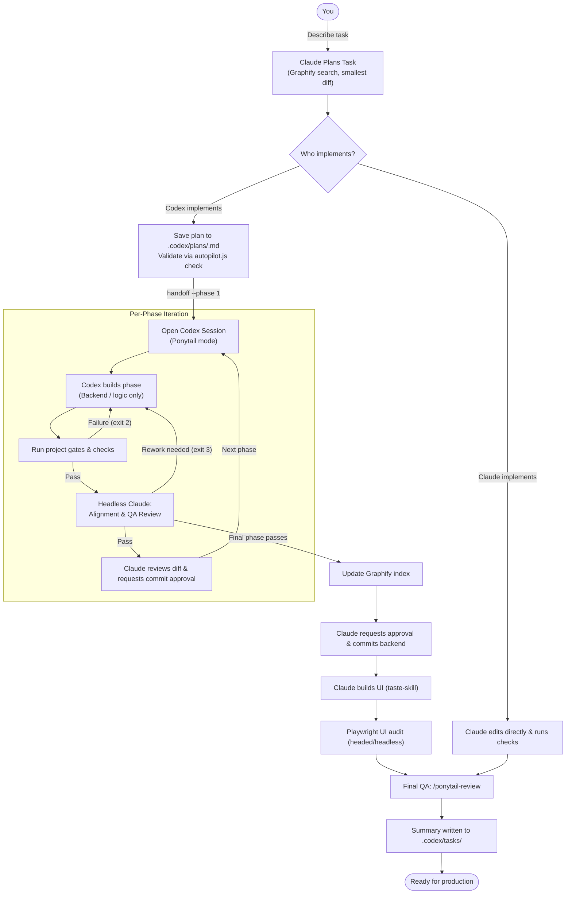

# Dual-agent workflow (Claude + Codex)

A Claude Code plugin and standalone installer that lets Claude and Codex collaborate on a Git repository as a team. Claude plans, reviews, and builds the frontend; Codex implements backend logic, standalone functions, and scraping. Local scripts enforce gates and tests between every phase.

All configuration, logs, and task artifacts remain **strictly local to your clone** via `.git/info/exclude`. Tracked files are never modified without explicit approval.

---

## Available Commands

### Quick Installation

```text
# In Claude Code (Recommended):
/plugin marketplace add Jonrei1/dual-agent-workflow
/plugin install dual-agent-workflow@dual-agent-workflow
/dual-agent-workflow:setup --yes
```

```sh
# Standalone in terminal (no plugin required):
npx github:Jonrei1/dual-agent-workflow --yes
```

```text
# Single-agent variations:
/dual-agent-workflow:setup --yes --claude-only   # Claude plans and builds everything
/dual-agent-workflow:setup --yes --codex-only    # Codex plans and builds everything
```

### Command Reference

| Context | Command | Description |
|---|---|---|
| **Claude Code** | `/dual-agent-workflow:setup` | Set up or reconfigure workflow in current project |
| **Claude Code** | `/graphify .` | Build or update codebase knowledge graph |
| **Claude Code** | `/ponytail-review` | Run full senior-dev/QA review on current changes |
| **Codex CLI** | `/hooks` | Inspect and trust workflow and plugin hooks |
| **Terminal** | `node .codex/autopilot.js check <plan>` | Validate plan format, gates, and constraints |
| **Terminal** | `npx github:Jonrei1/dual-agent-workflow --dry-run` | Preview setup actions without modifying files |

---

## Installation & Setup

Follow these steps once per project (or clone).

### Prerequisites
- **Node.js**: v18+ for installer; v22+ LTS recommended for browser tooling.
- **Git**: Initialized repository (`git init` if starting fresh).
- **Accounts**: Active Claude Code and Codex CLI logins (`claude` and `codex login`).
- **Python** (optional): `uv`, `pipx`, or `pip` if graphify is not yet installed.

---

### Step 1: Install the Plugin or Runner
- **Via Claude Code**:
  ```text
  /plugin marketplace add Jonrei1/dual-agent-workflow
  /plugin install dual-agent-workflow@dual-agent-workflow
  ```
- **Via NPX**: No prior install needed—run `npx github:Jonrei1/dual-agent-workflow` directly in Step 2.

### Step 2: Initialize the Project
From your project root, execute setup:
```text
/dual-agent-workflow:setup --yes
```
*(Or run `npx github:Jonrei1/dual-agent-workflow --yes` in terminal).*

**What `--yes` installs automatically:**
- Global agent CLIs (`@anthropic-ai/claude-code`, `@openai/codex`) if missing.
- Playwright MCP server and matching Chromium build for headless and `playwright-headed` UI audits.
- Supporting plugins: **ponytail** (QA/senior reviewer), **taste-skill** (UI/UX direction), and **caveman** (terse token-saving replies).
- Codebase intelligence: **graphify** CLI and agent skills.
- Local orchestration scripts and templates under `.codex/` and `CLAUDE.local.md`.

### Step 3: Configure Verification Checks
Setup inspects your project (Node, Python, Go, Rust) and detects build/lint/test commands.
- If checks are missing or custom, create or edit `.codex/verify.json` (see [Configuration](#configuration)).
- For frontend apps, define the `ui` block (`startCommand`, `url`, `viewports`).

### Step 4: Restart and Trust Hooks
1. **Restart Claude Code**: Reloads local rules (`CLAUDE.local.md`), hooks, and plugins.
2. **Open Codex CLI**: Run `/hooks` in Codex and trust the workflow and ponytail hooks.
3. **Build Code Graph**: Run `/graphify .` in Claude Code to index project symbols.
4. **Keep Codex Open**: Leave an active Codex session open in the repository; Claude queues tasks directly into it.

---

### Setup Flags Reference

| Flag | Purpose |
|---|---|
| `--yes` | Automatically install missing tools, Playwright, Chromium, and plugins without prompts. |
| `--claude-only` | Configure workflow exclusively for Claude (plans, backend, and frontend). |
| `--codex-only` | Configure workflow exclusively for Codex (plans and full implementation). |
| `--project-only` | Write local project files only; skip global tool installs, browser downloads, and MCP setup. |
| `--tools-only` | Install global tools, Chromium, and user plugins only; leave project files untouched. |
| `--dry-run` | Output planned actions without writing any files or installing packages. |
| `--skip-playwright` | Omit Playwright MCP package, Chromium download, and browser registrations. |
| `--skip-skills` | Omit ponytail, taste-skill, and caveman helper plugins. |
| `--skip-graphify` | Omit graphify CLI, skills, and Claude guard hooks. |
| `--graphify-scope=user\|global` | Specify graphify installation scope non-interactively (default: `user`). |
| `--root <dir>` | Specify target repository directory if running from outside project root. |

---

## How It Works

### Architecture Overview



### Division of Responsibilities

| Component | Responsibility |
|---|---|
| **Claude Code** (Interactive) | Planning, task routing, UI implementation, Playwright browser audits, final QA pass, commit approvals. |
| **Codex CLI** (Interactive) | Backend logic, APIs, data processing, and standalone functions per phase handoff. Never touches UI. |
| **Headless Claude** (Read-Only) | Verification step grading Codex's implementation against plan acceptance criteria. |
| **ponytail** | Senior developer and QA reviewer plugin enforcing minimal diffs and clean architecture. |
| **taste-skill** | UI/UX design direction for clean interfaces when Claude builds frontends. |
| **caveman** | Enforces terse chat output to conserve context and reduce token costs. |
| **Playwright MCP** | Real-browser functional audits (`playwright` headless or `playwright-headed` visible window). |
| **graphify** | Code dependency graph enabling targeted context search instead of reading broad directories. |
| **autopilot.js** | Local orchestration script running test gates, phase handoffs, and verification. |

---

## Daily Task Workflow

1. **Describe the task** to Claude Code.
   - Claude inspects the codebase with `/graphify` and creates a phased plan.
   - Claude asks who implements: **Codex (default)**, **Claude directly**, or **Codex (manual phases)**.
   - For UI tasks, Claude asks whether to run browser audits **headed** (visible window) or **headless**.
2. **Plan Validation**:
   - Plan is saved to `.codex/plans/<task>.md` and verified with `autopilot.js check`.
   - Backend phases are strictly decoupled from frontend deliverables.
3. **Phase Execution (Codex)**:
   - Claude queues Phase 1 to your open Codex session via `codex queue`.
   - Codex implements the phase inside the defined scope.
   - Automated test gates and project checks execute locally.
4. **Alignment Verification**:
   - Headless Claude evaluates the diff against plan requirements.
   - If rework is needed, Codex receives actionable feedback.
5. **Interactive Checkpoints**:
   - Claude presents the phase diff and asks for approval before creating a Git commit.
   - Approved phases are committed; Claude then triggers the next phase handoff.
6. **Frontend & UI Audit (Claude)**:
   - Claude builds the frontend per UI specifications.
   - Claude audits the UI with Playwright across specified viewports and fixes defects.
7. **Final QA & Summary**:
   - Claude executes `/ponytail-review` across the full diff.
   - A task summary is generated in `.codex/tasks/<date>-<task>.md`.

---

## Configuration

Configure project checks and verification behavior in `.codex/verify.json`:

```json
{
  "checks": [
    "npm run typecheck",
    "npm run lint",
    "npm test"
  ],
  "parallelChecks": true,
  "alignment": {
    "model": "sonnet",
    "riskModel": "opus",
    "riskPaths": ["src/auth/**", "src/db/migrations/**"]
  },
  "ui": {
    "startCommand": "npm run dev",
    "url": "http://localhost:3000",
    "viewports": [375, 1280],
    "headed": false
  },
  "handoff": {
    "waitSeconds": 90
  }
}
```

- `checks`: Commands executed during phase verification (`[]` disables project checks).
- `parallelChecks`: Set to `false` if test runners conflict when run concurrently.
- `alignment.riskPaths`: Glob patterns triggering Opus alignment instead of Sonnet.
- `ui`: Dev server command, URL, viewports, and default browser mode.
- `handoff.waitSeconds`: Maximum timeout when dispatching tasks to Codex.

Verify detected checks at any time:
```sh
node .codex/hooks/claude-verify.js --print-checks
```

---

## Cost of a Run

- **Dual-agent mode**: Requires **(phases + reworks)** read-only headless Claude alignment calls per task. There are **no headless UI calls** (Claude audits its own frontend directly in your interactive session).
- **Single-agent modes**:
  - `--codex-only`: **1 + reworks** read-only `codex exec` alignment calls per task (on the final phase).
  - `--claude-only`: 0 headless verification calls.
- Phase gates and check failures before alignment trigger no model calls.

---

## Several developers, one repo

- **Zero Git Pollution**: All workflow files (`.codex/`, `CLAUDE.local.md`, logs, plans) are excluded via `.git/info/exclude`. Your `git status` stays clean.
- **No Direct Tracked File Edits**: The installer and sync script never write to tracked files.
- **Explicit Commits Only**: Agents never commit without your interactive review and approval.
- **Git Worktree Support**: For parallel tasks, create a worktree (`git worktree add ../feature-branch`). The workflow auto-syncs settings to new worktrees.

---

## Troubleshooting

| Problem | Solution |
|---|---|
| **Codex does not receive queued plans** | Ensure Codex CLI is running in the repository directory. Check that your Codex CLI is up to date (`npm i -g @openai/codex`). |
| **Playwright browser missing / failed audit** | Run `/dual-agent-workflow:setup --yes --tools-only` to ensure Chromium and Playwright MCP are installed. |
| **Headed browser fails to open on Linux** | Ensure a display server is running (`DISPLAY` or `WAYLAND_DISPLAY` set), or configure `"headed": false` in `.codex/verify.json`. |
| **Checks fail concurrently** | Set `"parallelChecks": false` in `.codex/verify.json`. |
| **Manifest warning during session start** | If `.codex/workflow-manifest.json` was committed accidentally, run `git rm --cached .codex/workflow-manifest.json` and re-run setup. |
| **Missing ponytail, taste-skill, or caveman** | Run `/dual-agent-workflow:setup --yes --tools-only` to reinstall user-scope plugins. |

---

## Upgrading

### From v4.x
Plugin sessions sync automatically on start. To update the plugin:
```text
/plugin update dual-agent-workflow
```
Then restart Claude Code.

### From v3.x or legacy `claude-codex-workflow`
Uninstall legacy package and add the new repository:
```text
/plugin uninstall claude-codex-workflow@claude-codex-workflow
/plugin marketplace remove claude-codex-workflow
/plugin marketplace add Jonrei1/dual-agent-workflow
/plugin install dual-agent-workflow@dual-agent-workflow
/dual-agent-workflow:setup --yes
```

---

## Development

Run test suite (Vitest):
```sh
npm install
npm test
```
*Tests use mock agent CLIs and isolated scratch environments without making remote API calls or altering your machine's configuration.*
